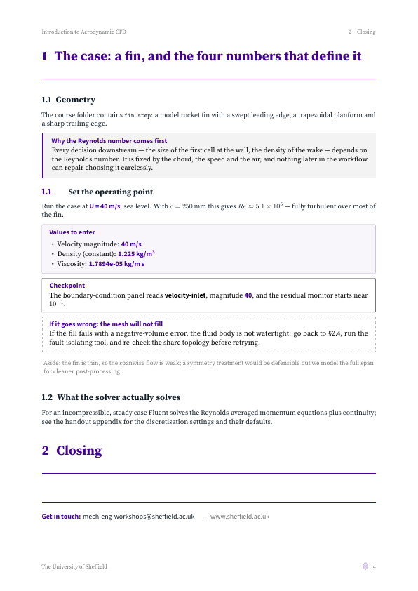
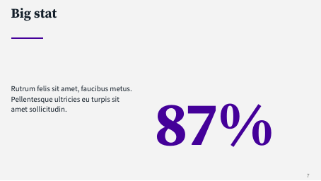

# Sheffield LaTeX Themes

Two LaTeX themes for the **University of Sheffield**, faithful to the
University's official "Core Presentation Template" (`template.pptx`) and
matching handout design:

1. **Beamer presentation theme** — `beamerthemeSheffield.sty`
2. **Document (article) theme** — `sheffielddoc.sty`, for handouts,
   workshop notes and reports

## What it looks like

Compile `example.tex` (`pdflatex example.tex`, run twice) — it reproduces
every slide type in the PowerPoint template:

| Template slide            | LaTeX                                     |
|---------------------------|-------------------------------------------|
| Title (`CUSTOM_2_1`)      | `\SheffieldTitlePage`                     |
| Section header (`CUSTOM_3`)| `\SheffieldSectionPage{...}`             |
| Title and text / columns  | normal `frame` / `columns`                |
| Big stat (`CUSTOM_5`)     | `\SheffieldStat{87\%}{description}`       |
| Get in touch (`CUSTOM_4`) | `\SheffieldClosing{email@sheffield.ac.uk}`|

## Brand implementation (extracted from template.pptx)

- **Purple `#440099`** — accent, section titles, big stats, crest
- **Ink `#131E29`** — body text and bullets (from the slide master)
- **Paper `#F3F3F3`** — background canvas
- **Mid grey `#747775`** — page numbers, secondary text
- **Source Serif Pro** — display face (titles, section headers, stats)
- **Source Sans Pro** — text face
- Watermarked divider backgrounds (arrows, rose, crown, book) taken
  directly from the template's 1920x1080 artwork
- University crest lockup and "A World TOP 100 University" mark from the
  template's media

Font sizes are the template's, scaled to beamer's 16 cm x 9 cm 16:9 canvas
(title 54→34 pt, section 52→33 pt, frame title 30→19 pt, body 18→11 pt,
big stat 140→88 pt, page number 13→8 pt).

## Document theme (handouts & reports)

`sheffielddoc.sty` styles the `article` class with the same brand: Source
Serif Pro headings in Sheffield purple over a full rule, Source Sans Pro
body, the white crest on a purple title band, and a small crest beside the
page number in the footer.

```latex
\documentclass[10pt,a4paper]{article}
\usepackage[most]{tcolorbox}          % load BEFORE the theme
\usepackage[hidelinks]{hyperref}
\usepackage[watermark=arrows]{sheffielddoc}
\sheffdocheader{Short document title} % header left + footer dept

\begin{document}
\ShefDocTitle{Document title}{Subtitle}{Meta line}
\ShefDocIntro{Left head}{Left text}{Right head}{Right text}

\ShefStep{A numbered step}            % auto-numbered per section
\begin{why}  ... \end{why}            % rationale box (purple side rule)
\begin{vals}... \end{vals}            % values-to-enter box (light purple)
\begin{chk}  ... \end{chk}            % checkpoint box
\begin{fail} ... \end{fail}           % troubleshooting box (dashed)
\ShefDocContact{[EMAIL]}
\end{document}
```

Body helpers: `\ui{Button}`, `\val{Value}`, `\file{name}`, `\menu{A \sep B}`,
`\boxlab{Label}`, `\sheffieldcrest[<height>]` (white crest). Sections,
lists, tables and `tcolorbox` are pre-styled; geometry, headers and
contents are set up automatically.

**`watermark=` option**: `none` (default) | `rose` | `arrows` | `crown` |
`book` — places one of the template's coat-of-arms motifs in the blank
space of the title page, bleeding off the right edge as in the University's
own artwork. The motifs are the tone-on-tone graphics from the template's
slide backgrounds, re-cut with transparency (`assets/wm-*.png`,
regenerated by `make_watermarks.py`).

A full example is `doc-example.tex` / `doc-example.pdf`.

| Title page | Body page |
|---|---|
|  |  |

## Usage

```latex
\documentclass[aspectratio=169]{beamer}
\usepackage[T1]{fontenc}
\usepackage[watermark=arrows,sectionpages]{beamerthemeSheffield}

\title{My lecture}          % rendered 34pt Source Serif Pro
\subtitle{Optional}
\author{A. Name}
\institute{The University of Sheffield}
\date{\today}

\begin{document}
\SheffieldTitlePage          % branded title frame

\section{Background}         % with `sectionpages`, dividers are automatic;
\SheffieldSectionPage{Background} % or place them by hand

\begin{frame}{Content title} % 19pt serif + purple rule
  \begin{itemize}\item ...\end{itemize}
\end{frame}

\SheffieldStat{87\%}{Description of the statistic.}  % inside a frame

\SheffieldClosing{me@sheffield.ac.uk}
\end{document}
```

### Package options

- `watermark=rose|arrows|crown|book|none` — motif on section pages
  (default `arrows`, as in the template)
- `sectionpages` — automatically insert a divider before each `\section`
- `nologos` — suppress the crest lockup and TOP 100 marks

### Fonts

Requires the `sourcesanspro` and `sourceserifpro` packages (TeX Live and
MiKTeX both have them; MiKTeX installs them on the fly). Overleaf works
out of the box.

## Files

- `beamerthemeSheffield.sty` — the theme
- `assets/` — backgrounds and logo artwork used by the theme
- `example.tex` / `example.pdf` — demonstration deck
- `make_assets.py` — regenerates `assets/` from the original .pptx media

## Installation

Copy `beamerthemeSheffield.sty` and `assets/` next to your `.tex` file,
or put the `.sty` in `texmf/tex/latex/beamerthemeSheffield/` and the
assets anywhere you point `\sheffieldassetdir{...}` at (default `assets`).

## Previews

| Title | Section divider | Big stat |
|---|---|---|
|  |  |  |

## Licence & brand note

Code is MIT-licensed. The University of Sheffield name, crest and "A World
TOP 100 University" mark are the University's trademarks; this theme
reproduces them from the University's own public presentation template for
use by University staff and students. Unaffiliated use of the marks is not
permitted by the University's brand guidelines.
